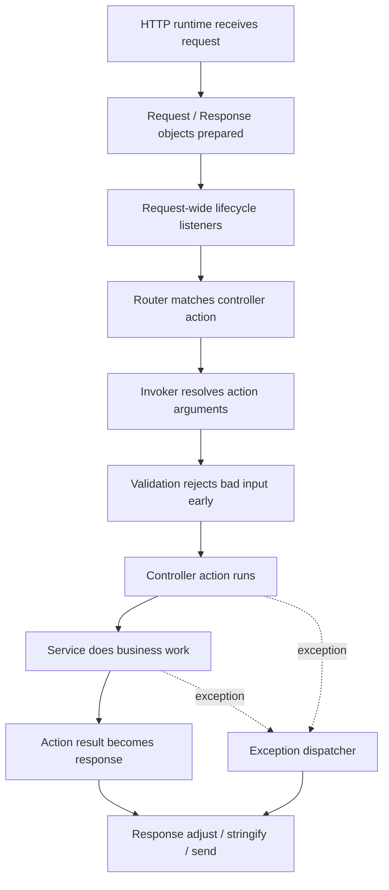

# Understand the request lifecycle {#request-lifecycle}

The shortest correct mental model for how one HTTP request moves through Switon before you study owner docs such as `http`, `router`, or `invoker`.

## Terms at a glance {#terms}

If one term here feels new, keep [Glossary for beginners and translators](glossary.md#glossary) open while you read.

- **lifecycle listener** — request-wide HTTP behavior such as request ids, CORS, auth loading, or access logs
- **route** — the matched controller/action target chosen by Router
- **request input object** — a typed input object built from request data before business logic runs
- **action** — the controller method that handles the matched route
- **normalization** — converting the action return value into the response body when you did not write the body manually

## Request map {#request-map}

Use this as the shortest "request enters here, response leaves there" picture:

Read that flow in plain language:

1. the HTTP runtime receives the request
2. Switon prepares request and response objects
3. request-wide listeners run
4. Router decides which controller action should handle the request
5. Invoker builds that action's arguments
6. validation protects the input boundary
7. controller code coordinates the request
8. service code does the reusable business work
9. the action result becomes JSON, HTML, or another response body
10. response headers and body are sent back to the client

If an exception escapes the controller or service, the request leaves the normal success path, goes through `Switon\Http\ExceptionDispatcherInterface`, and then continues to response sending.

## Who owns each step {#owns-each-step}

Use this table when the main beginner question is "which part of the framework is responsible here?"

| Stage | Main owner | What you usually touch first |
|---|---|---|
| request enters the app | HTTP runtime + bootstrap | usually the app entrypoint or dev server command, not application business code |
| request-wide behavior | lifecycle listeners under `Switon\Http\RequestHandlerInterface` | root `switon.yml` plus listener classes such as `app/Listener/...` |
| route selection | Router + controller mapping attributes | `app/Controller/...` and sometimes router prefix config |
| action arguments | Invoker + request/input binding | controller method signature and typed input objects |
| business work | services | `app/Service/...` |
| response shaping | `ResponseInterface` or `ViewRenderer` | JSON writes, returned arrays, or templates under `app/View/...` |
| escaped exceptions | `Switon\Http\ExceptionDispatcherInterface` | root `switon.yml` plus `app/ExceptionHandler/...` |

This is the main split to remember:

- transport-facing code decides **how the request enters**
- services decide **what the application does**
- HTTP decides **how success or failure becomes a response**

## Where code and config usually go {#code-config-go}

When you read a guide and wonder where to write something, use these defaults first:

- **controller actions** usually live in `app/Controller/...`
- **typed request input objects** usually live in `app/Input/...` or another app-owned input namespace the project already uses
- **request-wide lifecycle listeners** usually live in `app/Listener/...` and are registered under `Switon\Http\RequestHandlerInterface` -> `filters` in root `switon.yml`
- **services** usually live in `app/Service/...`
- **exception handlers** usually live in `app/ExceptionHandler/...` and are registered under `Switon\Http\ExceptionDispatcherInterface` -> `handlers` in root `switon.yml`
- **HTML templates** usually live in `app/View/...` when the app uses the default `@view` -> `@app/View` alias

One shortcut is worth memorizing:

- if the behavior should run for every request, it usually belongs in request-wide config plus a listener class
- if the behavior belongs to one route, it usually belongs on that controller action
- if the behavior should be reusable outside HTTP, it usually belongs in a service

## Where cross-cutting behavior lives {#cross-behavior-lives}

Switon does **not** use a chained `$next()` `$next()` pipeline as its main model.
Instead, request-wide behavior is attached to explicit lifecycle stages.

Use this split:

- **lifecycle listener** — request-wide work such as auth loading, request ids, access logs, CORS
- **controller interceptor** — action-specific wrapping logic
- **service** — business logic that should be reusable outside HTTP

That separation matters because request-wide policy and action-local policy are different boundaries.
If one concern should run for every request, prefer the lifecycle listener path.
If it wraps only one action or one controller, prefer the interceptor path.

One concrete shortcut helps here:

- if you would have put the behavior on every request, register a lifecycle listener under `Switon\Http\RequestHandlerInterface` -> `filters` in `switon.yml`
- if you would point at one controller method and say only this route needs it, keep it on that action as an interceptor or response attribute

Example split:

- **lifecycle listener:** load current identity, assign request id, add CORS headers
- **controller interceptor:** require JSON for one action family, reject one route before the action body runs

Use [Add cross-cutting HTTP behavior](../guides/add-cross-cutting-http-behavior.md#wiring-listeners) for the first wiring example and this page for the detailed lifecycle map.

## How errors become responses {#security-and-errors}

When an exception escapes controller or service code, Switon routes it through `Switon\Http\ExceptionDispatcherInterface` and lets the best-matching handler prepare the response.

That keeps a useful boundary in place:

- business code throws or propagates exceptions
- HTTP decides how those failures become HTTP output

Switon also treats `Switon\Core\StopFlow` as an intentional early-stop path for cases such as redirects or preflight handling.
That is different from an unexpected failure.

The practical rule is simple: prefer centralized exception-to-response policy over scattered local `try/catch` blocks in controllers.
Keep shared HTTP error mapping in one exception-handler path so the same exception becomes the same status code and response shape across routes.

## JSON and HTML share most of the path {#json-share-path}

JSON APIs and HTML pages use almost the same request path until the output stage.

- **JSON-first path** — controller returns arrays or writes through `ResponseInterface`
- **HTML path** — the request still routes and invokes the same way, but `View` / `ViewRenderer` shapes the final HTML output

That means the early concepts stay the same:

- route the request correctly
- bind and validate input clearly
- keep controllers thin
- keep business work in services

Only the response-shaping side changes later.
