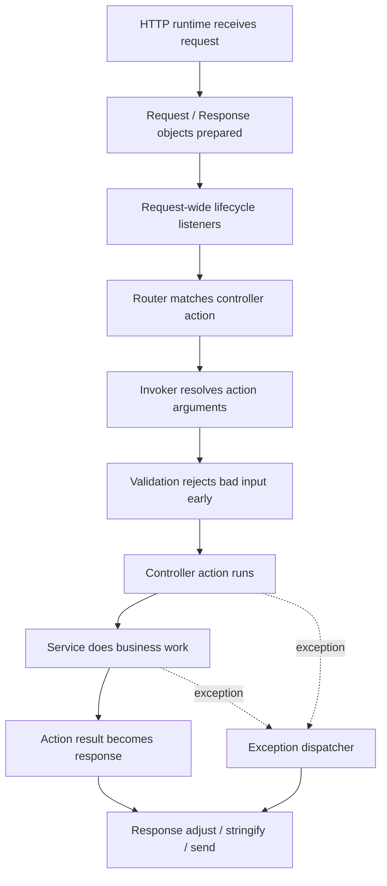

# 理解请求生命周期 {#request-lifecycle}

在研究 `http`、`router`、`invoker` 等 owner 文档之前，先用最短、正确的模型理解一次 HTTP 请求如何在 Switon 中流动。

## 术语速览 {#terms}

术语陌生时，边读边开着 [面向初学者与译者的术语表](glossary.md)。

- **lifecycle listener** — 请求级 HTTP 行为：request id、CORS、auth 加载、访问日志等
- **route** — Router 选中的 controller/action 目标
- **request input object** — 业务逻辑运行前由请求数据构建的 typed 输入对象
- **action** — 处理匹配路由的 controller 方法
- **normalization** — 未手写 body 时，把 action 返回值转成响应体

## 请求地图 {#request-map}

最短的“请求从哪进、响应从哪出”图景：

可以把这条流读成白话：

1. HTTP runtime 接收请求
2. Switon 准备 request、response 对象
3. 请求级 listener 运行
4. Router 决定由哪个 controller action 处理
5. Invoker 构建该 action 的参数
6. validation 保护输入边界
7. controller 协调请求
8. service 做可复用业务工作
9. action 结果成为 JSON、HTML 或其他响应体
10. 响应头与 body 发回客户端

若异常从 controller 或 service 逃出，请求就会离开正常成功路径，经 `Switon\Http\ExceptionDispatcherInterface` 继续走到响应发送。

## 各步由谁负责 {#owns-each-step}

主要初学者问题是「框架哪一段负责这里」时，用下表。

| 阶段 | 主要 owner | 你通常先动什么 |
|---|---|---|
| 请求进入应用 | HTTP runtime + bootstrap | 通常是应用入口或 dev server 命令，而非业务代码 |
| 请求级行为 | `Switon\Http\RequestHandlerInterface` 下的 lifecycle listener | 根 `switon.yml` 与 `app/Listener/...` 等 listener 类 |
| 路由选择 | Router + controller 映射 attribute | `app/Controller/...`，有时 router 前缀配置 |
| action 参数 | Invoker + request/input binding | controller 方法签名与 typed 输入对象 |
| 业务工作 | service | `app/Service/...` |
| 响应塑形 | `ResponseInterface` 或 `ViewRenderer` | JSON 写入、返回数组，或 `app/View/...` 模板 |
| 逃逸异常 | `Switon\Http\ExceptionDispatcherInterface` | 根 `switon.yml` 与 `app/ExceptionHandler/...` |

要记住的主拆分：

- 面向传输的代码决定**请求如何进入**
- service 决定**应用做什么**
- HTTP 决定**成功或失败如何变成响应**

## 代码与配置通常放哪 {#code-config-go}

读指南时不确定写在哪，先用这些默认：

- **controller action** 通常在 `app/Controller/...`
- **typed request input object** 通常在 `app/Input/...` 或项目已有的输入命名空间
- **请求级 lifecycle listener** 通常在 `app/Listener/...`，并在根 `switon.yml` 的 `Switon\Http\RequestHandlerInterface` → `filters` 注册
- **service** 通常在 `app/Service/...`
- **exception handler** 通常在 `app/ExceptionHandler/...`，并在根 `switon.yml` 的 `Switon\Http\ExceptionDispatcherInterface` → `handlers` 注册
- **HTML 模板** 在使用默认 `@view` → `@app/View` 时通常在 `app/View/...`

值得记住的捷径：

- 行为应对每个请求运行 → 通常在请求级配置 + listener 类
- 行为只属于一条路由 → 通常在该 controller action
- 行为应在 HTTP 外复用 → 通常在 service

## 横切行为放哪 {#cross-behavior-lives}

Switon **不**把链式 `$next()` pipeline 当作主模型。请求级行为挂在明确的生命周期阶段上。

拆分：

- **lifecycle listener** — 请求级工作：auth 加载、request id、访问日志、CORS
- **controller interceptor** — 仅包裹某一 action 的逻辑
- **service** — 应在 HTTP 外复用的业务逻辑

请求级策略和 action 局部策略是不同边界。若某个关注点应该对每个请求运行，优先 lifecycle listener；若只包一个 action 或 controller，优先 interceptor。

具体做法：

- 本会放在「每个请求」上的行为 → 在 `switon.yml` 的 `Switon\Http\RequestHandlerInterface` → `filters` 注册 lifecycle listener
- 本会指着某个 controller 方法说「只有这条路由需要」→ 留在该 action 的 interceptor 或 response attribute

示例拆分：

- **lifecycle listener：** 加载当前身份、分配 request id、加 CORS 头
- **controller interceptor：** 某 action 族要求 JSON、某路由在 action 体运行前拒绝

首次接线示例见 [添加横切 HTTP 行为](../guides/add-cross-cutting-http-behavior.md#wiring-listeners)；本页提供完整的生命周期地图。

## 错误如何变成响应 {#security-and-errors}

异常从 controller 或 service 逃出时，Switon 会通过 `Switon\Http\ExceptionDispatcherInterface` 路由，由最匹配的 handler 准备响应。

有用边界：

- 业务代码抛出或传播异常
- HTTP 决定失败如何变成 HTTP 输出

`Switon\Core\StopFlow` 也被视为有意早停路径，例如重定向或 preflight，与意外失败不同。

实用规则：优先采用集中式“异常 → 响应”策略，而不是在 controller 里散落 `try/catch`。共享 HTTP 错误映射放在一条 exception-handler 路径里，让同一异常在各路由上得到相同的状态码和响应形状。

## JSON 与 HTML 共享大部分路径 {#json-share-path}

JSON API 与 HTML 页面在输出阶段之前几乎走同一条路径。

- **JSON 优先** — controller 返回数组或通过 `ResponseInterface` 写入
- **HTML** — 仍同样路由与 invoke，但由 `View` / `ViewRenderer` 塑形最终 HTML

因此早期概念相同：

- 正确路由
- 清晰绑定与校验输入
- controller 保持薄
- 业务工作在 service

真正不同的只是后面的响应塑形。
